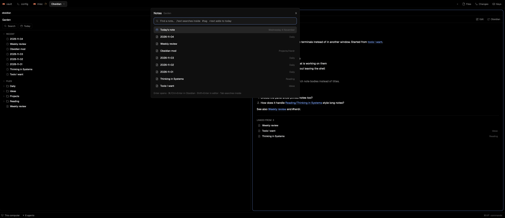

# herdr-obsidian

Your [Obsidian](https://obsidian.md) vault inside the [Herdr](https://herdr.dev) desktop app.



- **Search popup** (`ctrl-b f`): find a note by name, `/words` to search inside notes, `#tag` to list a tag, `+text` to add a line to today's daily note. Enter opens the note in a viewer pane, Cmd/Ctrl+Enter opens it in Obsidian, and Shift+Enter in your editor.
- **Side panel** (`ctrl-b a`): recent notes and the vault's folder tree, kept in sync with the files on disk.
- **Note viewer**: a rendered note beside your terminals. `[[links]]` are followed in place, a back button returns, notes that link here are listed underneath, and it redraws when the file changes.
- Daily notes follow your Obsidian settings (folder, date format, template), and new notes go where Obsidian puts them.

## Install

```sh
git clone https://github.com/cunderw/herdr-obsidian
./herdr-obsidian/install.sh
```

Then merge `keys.json` into `~/.config/herdr-app/keys.json`, or bind the keys you like.

`install.sh` copies the mod into `~/.config/herdr-app/mods/obsidian`, because a symlinked mod folder doesn't draw its icons. Run it again after pulling.

The vault is the one Obsidian has open. To pick another vault, or to set your editor, write `~/.config/herdr-app/obsidian.json`:

```json
{ "vault": "~/Notes", "editor": ["nvim"] }
```

## What it touches

It runs `rg` (falling back to `find`/`grep`), `open`/`xdg-open`, `mkdir` and your editor. It reads your vault and Obsidian's config. It writes to your vault only when you create a note, open today's note, or add a line with `+text`.

[RECIPE.md](RECIPE.md) has the full brief. Icons are from [Lucide](https://lucide.dev) (ISC).
