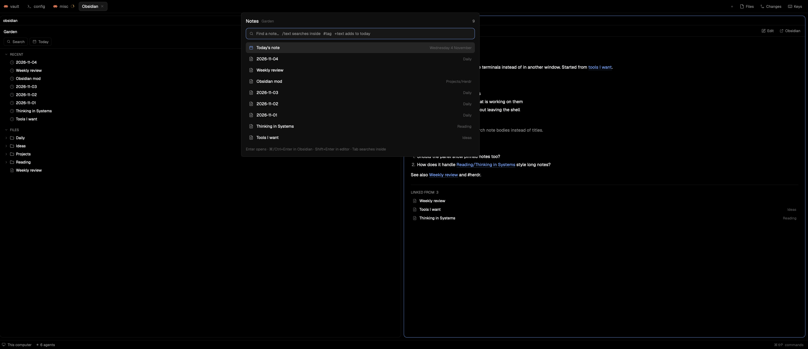

# Obsidian

Your Obsidian vault inside Herdr, as shared memory between you and your agents. A search popup finds any note by name, searches inside notes, lists a tag, adds a line to today's note, or saves an agent's last reply as a note. A side panel shows your recent notes and the vault's folders. Notes open in a viewer pane beside your terminals, with their links followed in place and the notes that link to them listed underneath; the viewer edits the note in place and sends it into an agent's prompt.

## What you see

- **Search popup**, 760 by 560px, 40px from the top of the window, on the `popover` color.
  - A heading on the left: "Notes" in 15px semibold, then the vault's name in 12px `dim`. On the right is the result count in 12px `muted`, shown as "200+" when the list is cut off.
  - A 36px input with 9px corners and an `accent` border on `raised`, with a 14px search icon (a robot icon in `>` mode). Its placeholder lists the prefixes: `Find a note…   /text inside   #tag   +text adds to today   >title saves a reply`.
  - Up to 10 rows, each with an icon, the note's title and its folder on the right (12px `dim`). Rows are 34px tall, or 46px for a text match, which adds the matching line underneath in 12px `muted`. The selected row is `selected` and hovered rows are `hover`.
  - A one-line hint in 12px `dim` at the bottom.
  - With nothing typed, the first row is "Today's note" with the date ("Wednesday 4 November") and an `accent` calendar icon. When there is an agent to read from, the second is "Save last reply from <agent>" with an `accent` robot icon and `>` on the right. The vault's notes follow, newest first.
  - In `>` mode the heading reads "Save a reply" and two 46px rows show the reply's start as their second line: `New note “<title>”` (plus icon) and `Append to today's note under “## From <agent>”` (calendar icon), each with "last reply" (or "screen text") on the right. The footer names the agent.
- **Side panel**, on `chrome`:
  - A header with the vault name (13px semibold) and two 26px outlined buttons, Search and Today.
  - A RECENT section (11px semibold `muted` caps) with the 8 most recently changed notes. Each has a clock icon and its folder in 11px `dim`.
  - A FILES section showing the note count, then the vault's tree: folders first, with chevrons, indented 14px per level; then notes, sorted by name with numbers in order. Rows are 26px.
- **Note viewer** pane, on `background`:
  - A 36px `chrome` header with a back chevron when there is history, a file icon in `accent`, the title (13px semibold) and its folder (12px `dim`). On the right are 24px text buttons with 13px icons, 12px `muted`: **Send**, **Edit**, **Editor** and **Obsidian**.
  - Editing, the file icon becomes a pencil, the folder text becomes "editing · Esc views" (or "edited · ⌘S saves · Esc views", Ctrl+S off macOS), and the buttons are **Send**, **Revert** and **Save** (`accent`, only when there are changes), **View**, **Editor**, **Obsidian**. The body is Herdr's editor: markdown, the terminal font at 13px, soft-wrapped, no line numbers, 10px by 6px padding.
  - When the file changed on disk under unsaved edits, a `raised` strip under the header says in `blocked`: "This note changed on disk since you started editing. Saving is refused so the change isn't lost.", with a **Load disk version** button.
  - The note rendered as markdown, 14px, with 22px and 16px padding. Front-matter tags show above it as `accent` pills on `raised`.
  - "LINKED FROM n" with a row for each note that links here, up to 50.

## How it behaves

- **Popup** (`ctrl-b f`):
  - Typing filters notes by title and path; every word must match. An exact title comes first, then titles that start with the text, then titles that contain it, then path matches. Recency breaks ties.
  - When nothing matches the name exactly, the last row is `Create “text”`, which makes an empty note where Obsidian's "new file location" setting puts new notes and opens it in your editor.
  - `/words` searches inside notes (up to 3 lines per note, 400 results). The search starts 160ms after you stop typing. Tab switches between name and text search.
  - `#tag` lists the notes tagged with it in the text (`#tag`, `#tag/child`) or in the front matter (`tags: [a, b]` or a YAML list).
  - `+text` shows one row, "Add to today's note: text". Enter appends `- text` to today's daily note, creating it from the daily-notes template if needed, and shows a toast.
  - `>` (or Enter on "Save last reply from …", which types `>`) reads the agent's last reply once. `>My title` names the new note; with no title it takes the reply's first sentence, without markdown or quotes, at most 60 characters. Enter on the first row writes a new note with the reply where Obsidian puts new notes (a taken name gets " 2", " 3"; nothing is overwritten) and opens it in the viewer. The second row appends `## From <agent>` and the reply to today's note.
  - Alt+Enter, or an Alt+click, sends the selected note (or today's note) to the agent: it lands in the agent's prompt unsent, and a toast says "Sent to <agent>".
  - Enter opens the note in the viewer. Cmd+Enter (Ctrl+Enter elsewhere) opens it in the Obsidian app, and Shift+Enter in your editor. Clicks with the same modifiers do the same.
  - The popup closes when its action is done, not before: closing it ends its tasks.
  - Up/Down or Ctrl+J/K move the selection, and Escape closes the popup.
- **Viewer**:
  - A note opens in the viewer already in the current tab, if there is one, or else in a new split to the right.
  - Clicking `[[link]]`, `[[link|alias]]`, `[[link#heading]]` or a relative `.md` link replaces the note in place, and the back chevron returns to the previous one. Links resolve the way Obsidian resolves them: an exact path first, then the shortest path with that file name.
  - A link to a missing note shows a toast. Links to attachments open in the system's default app, and web links in the browser.
  - The note redraws when its file changes on disk.
  - Editor opens `$VISUAL`, else `$EDITOR`, else `vi` in a split, passing `+line` only to editors that understand it. Obsidian opens the note in the app.
  - Send pastes `From my note "<title>" (<path>):`, a blank line and the whole note (front matter included; the draft while editing) into the agent's prompt as one paste, without Enter. The agent's pane takes the keyboard, switching tabs if it is in another one. The whole note goes, because the rendered view exposes no selection.
  - Edit switches to the editor with the file as it is. Cmd+S or Ctrl+S, or Save, writes it only if the file still holds what editing started from, then toasts "Saved". If the file changed meanwhile, the save is refused with a toast and the strip above; nothing is overwritten. Revert and Load disk version put the file's current text in the editor.
  - Escape or View goes back to the rendered note. Unsaved edits are kept: the header says "unsaved edits", Edit shows "Edit •" and returns to them, and following a link or going back is refused with a toast until they are saved or reverted. A file changed on disk while the draft is clean replaces the draft.
- **Panel** (`ctrl-b a`):
  - Clicking a folder expands or collapses it, and clicking a note opens it, with the same modifiers as the popup. Clicking RECENT folds that section.
  - Which folders are open, and whether RECENT is folded, are remembered.
  - The panel follows the vault on disk, so notes made in Obsidian show up within half a second.
  - `pane.go` can put the keyboard in the panel. Then Up/Down move, Right/Left open and close folders (Left on a note jumps to its folder), Enter opens, and Escape goes back left.
- The vault is found automatically: the one Obsidian has open, else the one it opened last.
- **The agent** for Send and Save: the agent terminal focused now (the popup opens over it), else the one focused last, else the only agent in the current tab, else the one an agent block shows. Clicking a viewer button gives the viewer the keyboard, which is why "focused last" exists. With none, a toast or the popup says to click into an agent.
- **The last reply**: for Claude Code, the assistant text since the person last wrote, read from its transcript. For other agents, or an agent on another machine, the last 120 lines of its screen.

## Built from

- One mod, `mods/obsidian/`. `mod.json` sets `place: "none"`, so nothing docks into your layout, plus `focusable: true` and the popup overlay.
- `main.js` chooses a view by `props()`:
  - opened with `mod.open`, it is the search popup, `search.js`
  - `{ view: "panel" }` is the panel, `panel.js`
  - `{ note: "<path in vault>" }` is the viewer, `note.js`

  `vault.js` holds everything shared: finding the vault, listing, matching, searching, link resolution, daily notes, new notes and opening. `agent.js` holds choosing the agent, sending a note and reading a reply. `main.js` calls `track()` on every render.
- Configuration is read in this order:
  - `obsidian.json` in your Herdr home, optional: `{ "vault": "~/Notes", "editor": ["nvim"], "dailyFolder": "Daily", "dailyFormat": "YYYY-MM-DD", "dailyTemplate": "Templates/Daily" }`. Every key is optional.
  - Obsidian's vault list: `~/Library/Application Support/obsidian/obsidian.json` on macOS; `~/.config/obsidian/`, Flatpak and Snap on Linux; `AppData/Roaming/obsidian` on Windows.
  - The vault's own `.obsidian/daily-notes.json` (`folder`, `format`, `template`) and `.obsidian/app.json` (`newFileLocation`, `newFileFolderPath`).
- Agents:
  - `track()` stores the focused agent terminal under shared `"obsidian.agent"` (`{terminal, at}`) whenever a copy draws and `focused().terminal` is in `agents()`. Herdr redraws mods on every focus change.
  - Sending: `cx.write_to_clipboard(text)`, `run("pane.focus", {terminal})`, `run("terminal.paste")`, then after 400ms the clipboard's earlier text goes back if it still holds the note. `terminal.paste` is Cmd+V: bracketed paste, so Claude Code shows "[Pasted text #1 +N lines]" and doesn't submit.
  - The reply: `terminals()[i].foreground.pid` → `~/.claude/sessions/<pid>.json` `sessionId` → `~/.claude/projects/*/<id>.jsonl`; while Claude Code runs a tool the foreground is the tool, so then the newest `.jsonl` in the project folder named after the terminal's folder (every non-alphanumeric character a `-`). The last 1.5 MB is read with `tail -c`, walked backwards: `assistant` lines' `text` blocks are collected until a `user` line that is not only `tool_result`s and not `isMeta`; sidechains are skipped. Without a transcript, `hc read <terminal> --lines 120`.
- Programs it runs, through `exec`:
  - `rg` to list files newest first and to search; `find` and `grep` when `rg` is missing.
  - `open` on macOS, `xdg-open` on Linux and `cmd /c start` on Windows, for `obsidian://open?path=…`, web links and attachments.
  - `mkdir -p` when a daily note's folder doesn't exist yet.
  - `sh` to start your editor and to list transcripts (`ls`), `tail` to read one, `hc read` for screen text.
- It reads files in your vault, Obsidian's config and Claude Code's `~/.claude/sessions` and `~/.claude/projects`. It writes only to your vault, and only when you create a note, open today's note, add a line with `+text`, save a reply, or save an edit. Writes use `writeTextFile` with the previous contents (`null` for a new note), so a change made at the same moment is never overwritten.
- The editor: `EditorState.new({ language: "markdown", value, soft_wrap: true, line_numbers: false, folding: false, font_family: settings().font_family, font_size: 13, syntax })` made in the Edit click handler, shown with `Editor.new(state)`, its `change` event keeping the dirty flag. The snapshot a save must match is frozen when editing starts, not taken from the watcher's latest read.
- Keys, in the repo's `keys.json` `mod:obsidian` section: `alt-enter` → `obsidian.send`, `cmd-s` and `ctrl-s` → `obsidian.save`, beside `ctrl-j`/`ctrl-k`. Every shown copy gets a mod command, so only the popup acts on `send` and only an editing viewer on `save`. The viewer also catches Cmd/Ctrl+S and Escape itself in `on_key_down`, so saving works without the keys merged; a `saving` flag stops a double save.
- Herdr functions:
  - views and data: `props`, `focused`, `panes`, `spaces`, `agents`, `terminals`, `theme`, `settings`, `window`, `shared`, `setShared`, `nextCommand`, `notify`
  - files: `readTextFile`, `writeTextFile`, `watchFolder`
  - running things: `exec`, `hc`, `run`; `cx.read_from_clipboard`, `cx.write_to_clipboard`, `cx.sleep`
  - commands: `pane.split` (with `mod`/`props` and with `argv`), `mod.open`, `pane.go`, `pane.focus {terminal}`, `terminal.paste`
- Panes talk to each other through shared state. Viewers list their tab under shared `"obsidian.viewers"`, and openers send `{ tab, note, n }` on shared `"obsidian.show"`. A mod pane isn't given its pane id, so a viewer takes its tab from `focused().tab` when it starts. A copy starts the first time its tab shows, so that is its own tab.
- The icons are Lucide (ISC) line icons, drawn with `svg()` and tinted: besides the originals, `send`, `pencil`, `eye`, `save`, `undo` and `bot`.

## Watch out

- **Install by copying, not by symlinking the folder.** A symlinked mod folder loads its JavaScript but draws no icons, and symlinking the files one by one fails to load ("resolves outside the application directory"). `install.sh` copies the files in.
- Copies of one mod don't share module state, so the popup, panel and viewers can only talk through `shared()`.
- **`hc send` is the wrong way to put text in a prompt.** It wraps the text in `<hc from=…>` tags and presses Enter. `hc keys` presses named keys only, and `hc attach` is a framed stream that also sizes the terminal. Herdr's `terminal.paste` with the clipboard is the one unsent, single paste. `terminal.paste` takes no target, so `pane.focus {terminal}` comes first. herdr-sessions uses the same route; this mod writes the clipboard with `cx.write_to_clipboard` rather than `pbcopy`, so it needs no per-platform program (`wl-copy`, `xclip`, `clip`).
- **Closing the popup ends its tasks.** An action that closes the popup first and then awaits (a send, a save) silently does nothing. Close it last.
- **A click or key handler's `cx` dies at its first `await`.** Every action that awaits starts with `cx.spawn((cx) => …)`, and `EditorState.new` runs in the click handler itself, before any await.
- The paste briefly replaces the clipboard. Only text can be put back; a clipboard holding an image ends up holding the note, and a clipboard manager records the note.
- `focused().terminal` is null while a mod pane has the keyboard, so the viewer's Send relies on the agent tracked last. Tracking happens only while some copy of this mod is drawn.
- Transcripts outgrow `readTextFile`'s 1 MiB cap; read the tail with `exec`. `~/.claude` ignores everything in its `.gitignore`, so `rg` there finds nothing without `--no-ignore`.
- Alt+Enter in the popup needs the `keys.json` binding: the input's own Enter handling only reports Cmd and Shift. Without it, Alt+click still sends.
- Obsidian rewrites `.obsidian/workspace.json` constantly. The panel ignores changes under `.obsidian`, `.git` and `.trash`, and waits 400ms for changes to settle. Without that, it would redraw the window nonstop while Obsidian is open.
- Notes the vault's `.gitignore` excludes, and files in hidden folders, are skipped, because ripgrep skips them.
- Daily-note formats support the common moment.js tokens (`YYYY YY MMMM MMM MM M Do DD D dddd ddd HH H mm ss` and `[literal]`), not locale formats like `LL`.
- The viewer renders standard markdown. Obsidian extras are approximated:
  - callouts become a bold title in a blockquote
  - `==highlight==` becomes bold
  - `![[embeds]]` become links
  - `%%comments%%` are dropped

  Dataview, Mermaid and LaTeX show as plain text or code.
- The viewer doesn't scroll to a line; `+line` only reaches the external editor.
- Send sends the whole note: `TextView` has no selection API, and neither has `EditorState`.
- `ctrl-b f` and `ctrl-b a` are suggestions. Change them if you use those keys. `ctrl-j`/`ctrl-k` only apply while the popup has the keyboard.
- Text and tag search need `rg` for the best results. Without it, front-matter tags in YAML lists aren't found.

## Done when

- `herdr-app check mods/obsidian` passes.
- `herdr-app do mod.open --name obsidian` shows the popup with "Today's note" first and your notes newest first.
- Typing `/` and a word lists matching lines, and `#` plus a tag lists tagged notes.
- `+hello` and Enter adds `- hello` to today's daily note, creating it if needed.
- Enter on a note splits a viewer to the right. A second note from the popup replaces it rather than adding a split.
- Clicking a `[[link]]` in the viewer shows that note, and the back chevron returns to the first.
- `pane.split {direction: "right", mod: "obsidian", props: {view: "panel"}}` shows Recent and the folder tree. Saving a new note in Obsidian adds it to the panel.
- With a viewer beside a Claude Code agent, Send leaves "[Pasted text #1 +N lines]" in the agent's prompt, the agent stays idle, and submitting it shows `From my note "<title>" (<path>):` then the note. The clipboard's earlier text is back.
- `>` in the popup over that agent shows its last reply; Enter on the first row makes a note holding it and opens it; Enter on the second appends `## From <agent>` and the reply to today's note.
- Edit, a change, and `herdr-app do obsidian.save` writes the file. Edit, a change, then appending to the file from a shell: the strip appears, saving is refused, and the file keeps the shell's line.
